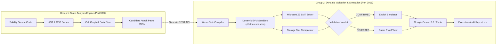

# SmartShield: Unified DelegateTracker Pipeline

> **Automated Detection, EVM Dynamic Validation, and Grounded AI Remediation of Unvalidated `delegatecall` & Storage Layout Collision Vulnerabilities in Ethereum Smart Contracts.**

---

## 📌 Overview

SmartShield is an end-to-end smart contract security analysis framework that bridges **static AST data-flow analysis** with **dynamic EVM symbolic execution** and **grounded generative AI**.

The pipeline is split into two specialized cooperating micro-services:
1. **Group 1 (`SmartShield` — Port 3000)**: Static AST parser, call-graph builder, control-flow graph (CFG) analysis, and heuristic search for candidate delegatecall attack paths.
2. **Group 2 (`smartshield-group2` — Port 3001)**: Dynamic EVM sandbox runner (`@ethereumjs/vm`), Microsoft Z3 SMT constraint verification, storage slot collision comparator, exploit replay simulator, and evidence-grounded AI audit reporting powered by **Google Gemini**.

---

## 🏛️ System Architecture



---

## ⚡ Prerequisites

- **Node.js**: `v18.0.0` or higher (recommended: `v20+`)
- **npm**: `v9.0.0` or higher
- **Operating System**: macOS, Linux, or Windows (WSL2)
- *(Optional)* **Google Gemini API Key**: For live AI-grounded vulnerability explanations and audit report synthesis.

---

## 🚀 Quick Start (One Command)

You can launch both Group 1 and Group 2 services concurrently using the root runner:

```bash
# 1. Clone the repository
git clone https://github.com/AmeyPatil3/BlockChain.git
cd BlockChain

# 2. Install dependencies (if not already installed)
cd SmartShield && npm install
cd ../smartshield-group2 && npm install
cd ..

# 3. Start both services
./start.sh
```

*(Alternatively, run `npm start` from the repository root).*

Once started:
- **Group 1 UI (Static Analysis)**: [http://localhost:3000](http://localhost:3000)
- **Group 2 UI (Dynamic Validator & Simulator)**: [http://localhost:3001](http://localhost:3001)

---

## 🔑 Configuring Google Gemini AI

SmartShield features grounded AI threat analysis that synthesizes explanations and audit reports strictly bound to verified EVM storage slot modifications and Z3 proofs.

1. **Option A (UI Modal)**:
   - Navigate to [http://localhost:3001](http://localhost:3001).
   - Click the **`✨ Gemini AI`** button in the top navigation bar.
   - Enter your Gemini API key and click **Save & Activate**.

2. **Option B (`.env` file)**:
   - Copy `.env.example` in `smartshield-group2`:
     ```bash
     cp smartshield-group2/.env.example smartshield-group2/.env
     ```
   - Set your API key:
     ```env
     GEMINI_API_KEY=your_gemini_api_key_here
     ```

*(If no key is configured, SmartShield automatically uses its built-in deterministic verification engine).*

---

## 📖 End-to-End Walkthrough

### Step 1: Discover Attack Paths in Group 1
1. Open [http://localhost:3000](http://localhost:3000).
2. Upload or select a contract (e.g., `MultiPathVault.sol` or `MixedSecurityVault.sol`).
3. Click **Scan / Analyze**. Group 1 parses the AST, identifies `delegatecall` opcodes, extracts state variable read/write sets, and produces candidate attack paths.

### Step 2: Validate in Group 2 EVM Sandbox
1. Open [http://localhost:3001](http://localhost:3001).
2. Click **Sync from Group 1 (Port 3000)** in the top navigation bar.
3. Group 2 imports the active candidate paths and compiles the contract with Wasm solc.
4. Select any candidate attack path (`PATH-001`, `PATH-002`, etc.) to trigger:
   - **EVM Symbolic Execution**: Tracing `SLOAD` and `SSTORE` opcode accesses.
   - **Microsoft Z3 SMT Solver**: Checking access-control guard satisfiability (`SAT` vs `UNSAT`).
   - **Storage Slot Comparator**: Comparing expected vs runtime storage slot overwrites.

### Step 3: View Verdict & State Differences
- **CONFIRMED (Critical Exploit 🔴)**: The path successfully overwrites state variables (e.g. `owner`, `admin`) and reaches a sensitive sink.
- **REJECTED (Guarded 🟢)**: Access control checks halted execution (e.g. `require(msg.sender == owner)`).
- Click the **State Diff View** tab to inspect the before/after balances, slot addresses, and storage deltas.

### Step 4: Sandbox Exploit Simulation
- Switch to the **Exploit Simulation** tab.
- Replay the step-by-step transaction execution sequence inside the isolated EVM sandbox.

### Step 5: Grounded AI Explanation & Audit Report
- Switch to **Grounded AI Analysis** to view root-cause explanations and remediations generated by Gemini.
- Click **Generate Security Report** to export a formal Markdown audit report (`.md`).

---

## 🧪 Benchmark Contracts Included

The repository includes specialized benchmark contracts for validation:

| Contract | File | Description |
| :--- | :--- | :--- |
| **MultiPathVault** | [`MultiPathVault.sol`](./MultiPathVault.sol) | 6 candidate attack paths across 3 storage slots (`owner`, `admin`, `treasury`) and 3 sinks (`drainVault`, `emergencyWithdraw`, `destroyVault`). |
| **MixedSecurityVault** | [`MixedSecurityVault.sol`](./MixedSecurityVault.sol) | Mixed layout containing both vulnerable paths (`CONFIRMED` 🔴) and safely guarded paths (`REJECTED` 🟢). |
| **VulnerableOwnerProxy** | [`VulnerableOwnerProxy.sol`](./VulnerableOwnerProxy.sol) | Classic unvalidated delegatecall storage clash targeting slot 0. |

---

## 🛠️ Running Tests

To run the automated validation test suites:

```bash
# Run all tests across both groups
npm run test:all

# Run Group 1 static analysis tests only
npm run test:g1

# Run Group 2 EVM validator & milestone tests only
npm run test:g2
```

---

## 📁 Repository Structure

```
BlockChain/
├── SmartShield/                     # [Group 1] Static Analysis Engine (Port 3000)
│   ├── src/analyzer/                # AST, CFG, CallGraph, DataFlow & Delegatecall analyzers
│   ├── src/backend/                 # Express REST API routes
│   ├── src/frontend/                # React/Vite dashboard & visualizers
│   └── server.ts                    # Backend server entrypoint
│
├── smartshield-group2/              # [Group 2] Dynamic EVM Validator & Simulator (Port 3001)
│   ├── validator/                   # Wasm Solc compiler, @ethereumjs/vm runner, Z3 SMT solver
│   ├── simulator/                   # Local sandbox exploit replayer
│   ├── api/explain/                 # Google Gemini evidence-grounded explanation engine
│   ├── reports/                     # Formal Markdown audit report generator
│   ├── ui/                          # Interactive React dashboard & State Diff view
│   └── tests/                       # Automated milestone & EVM validation tests
│
├── MultiPathVault.sol               # Multi-path benchmark contract
├── MixedSecurityVault.sol           # Mixed confirmed/rejected benchmark contract
├── VulnerableOwnerProxy.sol         # Single-path benchmark contract
├── start.sh                         # Unified background launcher for both services
└── README.md                        # Project documentation
```

---

## 📜 License

MIT License. Designed and built for automated smart contract security verification.
